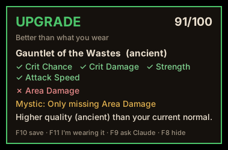

# D3 Helper

A Diablo 3 companion for Windows. **Hover an item in game and a card pops up next to it** telling you
what to do with it for your build.



- **Overlay**: rest the mouse on an item and a card says what to do in one line:
  *"Wear it - ancient beats your normal one"*, *"Salvage - your gloves slot is done"*,
  *"Spare - Enchant Vitality → Attack Speed at the Mystic to beat yours"*.
  It compares against the "Equipped" tooltip the game shows, so upgrades work with no setup.
- **Next steps (F7)**: your top 3 to-dos on screen, e.g. *"Get Pauldrons of the Wastes - Kadala shoulders,
  25 shards a try, can do ×25"*, plus what to farm when you're short (*"Farm Arreat War Tapestry: Act III
  bounties. Need 2 more for Extract Ambo's Pride"*). Warns when your blood shards are near the cap.
- **Stat goals**: the lowest roll you'll accept per slot (defaults provided, edit on the Goals page). An ancient
  item that meets every goal marks the slot **done**, and from then on copies of it are just salvage.
- **Hotkeys**:

  | Key | Does |
  |---|---|
  | F7 | Show / hide next steps |
  | F8 | Card: simple → details → off |
  | F9 | Ask Claude to read the hovered tooltip (needs an API key), or just save a screenshot |
  | F10 | Save the hovered item to your stash list |
  | F11 | "I'm wearing this": remembers the hovered item as equipped |

- **Dashboard** (opens in your browser): next steps, build checklist, **My stuff** (gold, shards, materials -
  type `2.5m` or `300k`), **Goals**, Kanai's Cube tracker, stash list, snapshots.

Hover reading uses the OCR built into Windows: free, offline, nothing leaves your PC.

## Setup

1. Install Python 3.12 or 3.13 from python.org (tick "Add Python to PATH").
2. Download this repo (Code → Download ZIP) and unzip it.
3. Double-click `run.bat`. The first run installs everything.
4. In Diablo 3: **Options → Video → Display Mode → Windowed Fullscreen**. In plain Fullscreen, Windows can't draw
   the overlay on top of the game.

If the overlay says the English OCR language pack is missing, open PowerShell as administrator and run:

```
Add-WindowsCapability -Online -Name "Language.OCR~~~en-US~0.0.1.0"
```

## If something's off

- **Card never shows**: make sure Diablo III is the focused window and in Windowed Fullscreen. Set `D3H_DEBUG=1` in
  `.env`; every read then saves a screenshot and the text it saw to `data\debug`.
- **Wrong name or stats**: try `D3H_OCR_SCALE=1.5`. Or press F9 to have Claude read it.
- **See exactly what it reads from a screenshot**:
  `.venv\Scripts\python -m d3helper.read data\snapshots\snap_....png --cursor 1500,600`
- **Card covers something**: pin it with `D3H_CARD_POS=40,40`.

All settings are in `.env.example` (copy it to `.env`).

## Optional extras

| Setting | What it unlocks | Cost |
|---|---|---|
| `ANTHROPIC_API_KEY` | F9: Claude reads the hovered tooltip | a few cents per read |
| `BLIZZARD_CLIENT_ID` / `_SECRET` | Import equipped gear by BattleTag on the dashboard | free ([develop.battle.net](https://develop.battle.net/access/clients)) |

## Your build and game data

Cube recipe costs, Kadala prices and farming spots are in `d3helper/game_data.json`; entries marked `verify`
should be checked in game. The build lives in `d3helper/builds/ww_rend_barb.json`. Slots marked `"verify": true` are a best guess; check them
against a current guide (Maxroll / Icy Veins) for your season. Edit item names or stat weights
(3 = must have, 2 = strong, 1 = nice) and restart.

## Development

```
python -m venv .venv && .venv\Scripts\activate
pip install -r requirements.txt
python -m pytest
python -m d3helper            # --no-overlay for dashboard only
```
